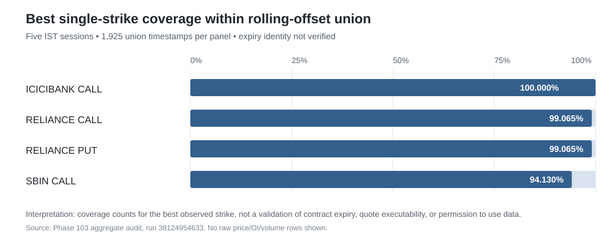

# Phase 103 Final Research Manuscript
## Historical data feasibility for intraday strategies in NIFTY 50 constituent stock options

**Version:** 1.1  
**Research date:** 11 October 2026  
**Branch:** `phase-103-nifty50-stock-options`  
**Research type:** preregistered data-source and contract-identity feasibility study  
**Decision:** **NO-GO for numerical intraday strategy P&L because contract identity / price reconciliation failed**  
**Strategy promotion:** None

---

## Abstract

This study assessed whether a preregistered initial universe of five NIFTY 50 constituents—HDFCBANK, ICICIBANK, RELIANCE, SBIN and INFY—could support a defensible intraday stock-options strategy backtest. The registered goal was repeatable positive net expectancy after realistic execution costs and independent chronological testing. Before any strategy return analysis, the plan required source access, exact option-contract identity, legally permitted data retention/caching, sufficient temporal coverage and executable historical price evidence.

The primary feasibility probe used Dhan's rolling-option endpoint on seven relative-strike offsets for four panels selected by a prior single-day alignment screen: ICICIBANK CALL, RELIANCE CALL, RELIANCE PUT and SBIN CALL. The bounded multi-session window covered five Indian trading sessions, 3–7 August 2026. The accepted run returned rows for all 28 probes and no timestamps outside the requested half-open date window. The corrected in-memory union diagnostic recorded 1,925 timestamps per panel and zero duplicate (timestamp, actual-strike) keys. Best observed per-strike union coverage was 100% for three ICICIBANK call strikes, 99.065% for the best RELIANCE call and put strikes, and 94.130% for the best SBIN call strike.

These results establish technical Dhan API access for aggregate rolling-strike observations over this short window, not a valid fixed-contract price tape. The user explicitly confirmed a Dhan subscription and authorization for this research; that confirmation is accepted as the access/entitlement assumption. Raw minute bars and raw NSE records remain ephemeral and are not put in the public repository or Actions artifacts. The independent NSE daily-contract cross-check found 88 eligible profiles, but only 3 matched all four OHLC fields uniquely; all three identified expiry 25 August 2026, none matched the expected second-expiry rank for expiryCode=1, and 85 were unmatched. A single near/current selector calibration using expiryCode=0 then returned HTTP 400 / DH-905: expiryCode is required on its first probe, so no price comparison was possible. The API does not document historical bid/ask/depth, and no valid strategy P&L, expectancy, drawdown or statistical-significance conclusion can be drawn. The data gate remains NO-GO for P&L until exact contract identity and executable-price evidence can be obtained; the subscription assumption is not the current blocker.

**Keywords:** Indian stock options; data provenance; contract identity; backtesting; market microstructure; transaction costs; execution feasibility; research reproducibility.

---

## 1. Introduction

### 1.1 Research problem

A trading rule cannot be credibly tested merely because an endpoint returns option price bars. The bar sequence has to correspond to the same tradable contract, the dates and timestamps must be correct, and the model must not treat non-executable prices as fills. This is particularly important when data are indexed by a rolling relative strike such as ATM or ATM+1: as the underlying moves, the actual strike assigned to an offset can change.

NSE's individual-security derivative contract definition identifies an option using the underlying, expiry date, option type and strike. Consequently, actual strike alone is not a sufficient identity key if expiry is unverified. The Dhan expired-options endpoint documents OHLC, implied volatility, volume, open interest, strike, spot and timestamp, but its observed response schema in this test did not return a per-row expiry date or immutable option contract ID. The request's expiry selector cannot be treated as a verified returned contract identifier.

### 1.2 Research question

Among the registered initial basket of five large NIFTY 50 constituents, can any rule-based stock-options strategy deliver repeatable positive net expectancy after realistic execution costs and survive chronological validation and independent out-of-sample testing?

**Primary conclusion for this manuscript:** the profitability question remains unanswered because source-identification and price-quality prerequisites failed. The NO-GO is not evidence that all stock-options strategies are unprofitable; it means this sample cannot yet support a valid P&L test.

### 1.3 Secondary questions

1. Does a source supply contract-specific strike/expiry/CE-PE identity and adequate synchronized histories?
2. Is executable historical pricing available, preferably bid/ask and quantity/depth at the required timestamps?
3. Are data acquisition, automated research, caching/retention and derived-publication rights documented?
4. Can costs be applied with date-effective Paytm Money brokerage, taxes/statutory levies, spread, slippage, latency and partial-fill risk?

### 1.4 Aims and objectives

**Aim.** Determine whether the registered stock-options strategy research can proceed without invalid contract stitching, unlicensed persistence or optimistic fill assumptions.

**Objectives.**
- Audit five fixed research symbols and the eligible stock/side panels.
- Verify rolling-offset API response integrity, date boundaries and actual-strike coverage.
- Compare feasible public, open-source, public-dataset and commercial-source leads.
- Identify remaining blockers and apply the preregistered stopping rule.
- Record a reproducible decision and a gated method for any future authorized-sample study.

---

## 2. Literature and source review

This section reviews research relevant to the validity of an options backtest and public data-source evidence. It is not a claim to be an exhaustive systematic review of all option-predictability literature; because the registered empirical test was blocked at data feasibility, it prioritizes contract identity, liquidity, bid-ask costs, data rights and backtest selection bias.

### 2.1 Option-market liquidity and execution costs

Option spreads are economically relevant because a trader buying at the ask and selling at the bid can lose the spread before other costs are counted. Pinder's empirical study of the Australian Options Market examined determinants of option bid-ask spreads and reported relationships with option value, time-to-maturity, absolute hedge ratio, underlying volatility and trading activity. Although this market and period are not India, the study supports the methodological point that quoted-option liquidity should be measured at contract level, not inferred from underlying liquidity alone. See Pinder, *An empirical examination of the impact of market microstructure changes on the determinants of option bid–ask spreads* (2003), [DOI](https://doi.org/10.1016/S1057-5219(03)00063-2).

Cho and Engle's work on S&P 100 index options finds that option spreads relate to spreads in the underlying and questions the use of option volume by itself as a liquidity measure. Kaeck, van Kervel and Seeger (2022) also examine the price-impact component of index-option spreads and note that significant measured impacts may be economically small relative to the size of spreads. Neither paper is a direct estimate of current NSE stock-option costs; they motivate collecting the correct variables and avoiding substitution of volume/OI for executable price evidence. See [Cho & Engle (NBER Working Paper 7331)](https://www.nber.org/papers/w7331) and [Kaeck et al. (2022)](https://doi.org/10.1016/j.finmar.2021.100675).

### 2.2 Backtest selection bias and statistical inference

Bailey and López de Prado's Deflated Sharpe Ratio paper describes how trying many strategies and selecting the winner creates performance inflation, compounded by non-normal returns and selection bias. Phase 103's plan therefore preregistered a small candidate set, chronological training/validation/test splits, an independent sealed holdout and multiple-testing adjustment rather than a broad unrecorded parameter sweep. These statistical corrections are useful only after the underlying trades and fills are defined correctly; they cannot repair unidentifiable contracts or fabricated prices. See Bailey & López de Prado, *The Deflated Sharpe Ratio: Correcting for Selection Bias, Backtest Overfitting, and Non-Normality* (2014), [DOI / journal record](https://doi.org/10.3905/jpm.2014.40.5.094) and [SSRN record](https://doi.org/10.2139/ssrn.2460551).

### 2.3 Data-source evidence

**Dhan rolling options.** The provider documents a rolling-option history endpoint returning minute OHLC, IV, volume, OI, strike and spot, and a request window limit. The endpoint is a feasible source for aggregate exploration, but its rolling-offset format and observed response schema do not by themselves establish a fixed expiry-specific contract tape. See [Dhan expired-options documentation](https://dhanhq.co/docs/v2/expired-options-data/) and [annexure](https://dhanhq.co/docs/v2/annexure/).

**NSE daily contract-wise reports.** NSE's public futures-and-options security report allows contract selectors and exposes daily prices/settlement, contract counts, turnover and OI. The public filter is time-limited and the data are EOD, so this is not a replacement for the registered intraday pricing requirement. See [NSE F&O security report](https://www.nseindia.com/report-detail/fo_eq_security).

**NSE historical data vending.** NSE lists subscription routes for EOD and historical order/trade data for F&O and publishes order/trade specifications and sample files. It is a credible official vendor inquiry route, but public documentation reviewed here does not settle the price, needed interval, available quote/depth fields or specific automated research, caching/retention and derived-publication rights for this project. See [NSE historical data subscription](https://www.nse.in/static/market-data/eod-historical-data-subscription) and [NSE Data & Analytics vending](https://www.nse.in/static/nse-data-and-analytics/data-information-vending). NSE's data policy describes use and distribution as subject to the applicable agreement, so open web visibility is not treated as a licence to bulk collect, cache or republish data. See [NSE Data Sharing & Usage Policy](https://www.nseindia.com/static/market-data/nse-data-policy).

**Open-source bhavcopy downloader.** The [jugaad-data repository](https://github.com/jugaad-py/jugaad-data) documents downloading NSE F&O bhavcopies, including stock options. This can support daily contract-level descriptive work where permitted, but it is not documented as historical one-minute executable quote/depth data and does not itself grant rights to underlying exchange market data.

**Hugging Face index-options datasets.** The [rissin/nse-options-intraday dataset](https://huggingface.co/datasets/rissin/nse-options-intraday) describes index options such as NIFTY, BANKNIFTY and SENSEX, not the preregistered constituent-stock options. The [TradeMarkk India index-options dataset](https://huggingface.co/datasets/thetrademarkk/india-index-options-1m) is also index-only and declares a non-commercial Creative Commons licence. Neither was substituted into this stock-options question: a different instrument universe is not a valid proxy for the registered population.

**Commercial archive lead.** [OptionVault](https://github.com/QuantDev-stack/OptionVault) advertises one-minute stock-options OHLCV/OI/Greeks as well as tick/level-2 data, but its public README describes the full archive as available to licensed users and evaluation samples as distinct from commercial access. A repository's MIT software licence does not establish a market-data licence. No access, price or permission was assumed.

**Synthesis.** The user-confirmed Dhan subscription provides access for this research, but the observed rolling-option endpoint has not passed exact-contract reconciliation and does not document historical bid/ask/depth. The accessible data have therefore not satisfied the two decisive empirical requirements: exact expiry/strike/CE-PE identity and adequate executable-price evidence. Raw rows are not published; only aggregate diagnostics and derived conclusions are.

---

## 3. Preregistered universe and scope

The Phase 103.0 initial research basket was frozen before strategy return testing:

| Symbol | Company | Reason for inclusion |
|---|---|---|
| HDFCBANK | HDFC Bank | Highest weight in the cited 27-Feb-2026 official index snapshot; option listings discoverable |
| ICICIBANK | ICICI Bank | Second-highest weight in the same snapshot; option listings discoverable |
| RELIANCE | Reliance Industries | Third-highest weight in the same snapshot; option listings discoverable |
| SBIN | State Bank of India | Large index weight and visible derivative activity |
| INFY | Infosys | Large IT exposure and visible derivative activity |

This is a fixed initial basket, **not** a proven rank by average option volume or spread. The multi-session Dhan data audit focused only on four panels—ICICIBANK CALL, RELIANCE CALL, RELIANCE PUT and SBIN CALL—selected from the prior single-day screen. Other stock/side panels were not promoted into this window based on incomplete prior coverage.

The current study is intraday stock-options data feasibility, not a test of NIFTY index options, and not a test of a deployable strategy.

---

## 4. Materials and methods

### 4.1 Data and bounded sample

The automatic GitHub Actions run [38124954633](https://github.com/vishnuvcr/Final-Stand-v5-1-1-1/actions/runs/38124954633) executed the Dhan audit for the target window **3 August 2026 inclusive through 10 August 2026 exclusive**. The target interval contained five sessions (3–7 August). Because empirical diagnostic runs found that the endpoint included the requested `toDate`, the client passed the preceding calendar date to the provider and then checked every timestamp against the original half-open target window.

Four stock/side panels were each queried for seven relative offsets: ATM, ATM+1, ATM+2, ATM+3, ATM-1, ATM-2 and ATM-3, for 28 probes. Raw response rows stayed in runner memory and were not stored in the public repository. Only an aggregate report was persisted.

### 4.2 Source integrity checks

The audit checked:
- successful response status and row availability;
- array-length consistency;
- target-window timestamp integrity;
- actual-strike changes within rolling offset lines;
- common and union timestamps across relative-offset series;
- unique pairs of timestamp and actual strike across the offset union; and
- per-strike observations, union coverage percentage, first/last UTC timestamp and IST-date counts.

The exact-strike diagnostic is descriptive, not an expiry/contract identity gate. A key `(timestamp, strike)` can be unique and well-covered while still being associated with an unverified expiry. Because the response does not deliver expiry and immutable contract ID fields in an audited row-level form, this analysis did not claim those keys uniquely identify listed option contracts.

### 4.3 Rights and execution gates

The user confirmed a Dhan subscription and authorization for this research, which is accepted as the access/entitlement basis for this work. Account-specific terms were not independently re-audited here. Raw Dhan minute rows and raw NSE contract records remain ephemeral and are not published; only aggregate diagnostics and derived conclusions are committed. The active blocker is the failed contract-identity / OHLC reconciliation and lack of historical bid/ask/depth, not the existence of an API subscription.

A valid backtest also required either historical executable quote/quantity evidence or a transparently validated conservative price proxy. Dhan's tested endpoint documents OHLC but not historical bid/ask/depth. No actual fill was inferred from the opening, high, low or close of a minute bar. The Paytm Money cost model could not be completed credibly before contract and executable-price data existed.

### 4.4 Planned statistical analyses (registered, not executed)

Had the data gates passed, the registered analysis would have:
1. locked small interpretable strategy and baseline families before validation;
2. split data chronologically into development, validation, frozen independent test and a separately sealed holdout;
3. used only features available at the decision time, with corporate actions, expiries, lot sizes and time zones reconciled;
4. reported gross/net P&L, mean and median net trade, expectancy, win rate, profit factor, return on deployed capital, drawdown depth/duration, tail loss, turnover, fill/exclusion rate and results by stock/regime/expiry;
5. modelled Paytm Money brokerage and statutory charges effective on each trade date, plus spread, adverse slippage, latency, market impact, partial fills, missed fills and multi-leg execution risk;
6. compared a base case with prespecified adverse-cost and execution stresses;
7. applied inference clustered by date/expiry, uncertainty intervals and multiple-testing correction; and
8. opened the independent holdout only once after rules and metrics were frozen.

These are planned analyses—not executed result claims. There is no trade-level sample in this manuscript, no P&L, and no estimated Sharpe/Sortino, confidence interval or statistical significance.

### 4.5 Stop rule

The Phase 103 plan says to stop and mark NO-GO when exact contract identity, permitted retention or adequate sample cannot be established. A source lead is not data evidence. The current intraday attempt therefore stops before strategy testing rather than substituting index options, filling gaps, pretending ATM offsets are fixed contracts or assigning optimistic transaction costs.

---

## 5. Results

### 5.1 Acquisition gate

| Diagnostic | Accepted result | Interpretation |
|---|---:|---|
| Workflow run | 38124954633, successful including publication | Reproducible run and result commit verified |
| Unit tests for this successful version | 20 passed | Audit and registration code checks passed before the explicit expiry identity amendment |
| Subsequent explicit-identity amendment tests | Run 38125302970; 21 tests passed | Corrected script/test runtime verified |
| Underlying IDs resolved | 5/5 | Mapping source step succeeded |
| Selected data probes returning rows | 28/28 | API acquisition pass for the four selected panels |
| Out-of-window row count | 0 | Requested half-open date boundary passed |
| Raw market rows published | No | Retention/redistribution terms not confirmed |
| Strategy P&L tests | 0 | Not run because data-validity gates failed |
| Strategy promotions | 0 | No evidence grade supports promotion |

### 5.2 Per-strike union coverage

Each of the four panels had 1,925 union timestamps over the five sampled sessions. Every panel's actual-strike/timestamp union had zero duplicate keys. However, the existence of a unique observation key is weaker than demonstrating a complete, expiry-verified contract history.

| Panel | Distinct strikes in union | Strikes observed at every union timestamp | Best individual strike coverage | Minutes observed / union | Exact expiry verified? |
|---|---:|---:|---:|---:|---|
| ICICIBANK CALL | 11 | 3 | 1430, 1440, 1450 at 100.000% | 1,925 / 1,925 each | No |
| RELIANCE CALL | 14 | 0 | 1300 at 99.065% | 1,907 / 1,925 | No |
| RELIANCE PUT | 14 | 0 | 1300 at 99.065% | 1,907 / 1,925 | No |
| SBIN CALL | 16 | 0 | 1060 at 94.130% | 1,812 / 1,925 | No |

*Figure 1. Highest observed per-strike timestamp coverage within the rolling-offset union, not a validation of expiry identity, executable quotes or data-use rights. Three ICICIBANK call strikes cover the union window; no single strike in either RELIANCE panel or SBIN CALL covers all union timestamps.*

### 5.3 Interpretation of observed coverage

- **ICICIBANK CALL:** some strike prices appear at each timestamp in the union, but strike continuity is not enough to establish one persistent listed contract when expiry is not audited.
- **RELIANCE CALL and PUT:** even the best strike misses 18 timestamps from the 1,925-point union in this sample; a strategy would need explicit coverage rules and cannot interpolate or silently fill.
- **SBIN CALL:** the best strike covers 1,812 of 1,925 union timestamps. This is below a fully continuous minute history and is not an executable quote history.
- **All four panels:** rolling relative offsets frequently change actual strike. Zero duplicate timestamp/strike keys does not mean a complete price tape or immutable contract identity. No panel passes the full registered contract-identity / execution-price gate.

### 5.4 Source screen

| Source lead | What public documentation supports | Why it does not clear this intraday gate |
|---|---|---|
| Dhan rolling-option endpoint | 28/28 code-1 probes returned rows in the audited sample | EOD reconciliation failed: 3/88 unique OHLC matches, all at expiry 2026-08-25; 85 unmatched; historical bid/ask/depth not documented |
| NSE public contract-wise report | Daily contract prices/settlement, volume/contracts, turnover and OI | EOD only and UI history range limited; cannot establish intraday fills |
| jugaad-data / F&O bhavcopy | Download path for daily NSE F&O files, including stock options | EOD data; client software licence is not data licence |
| Public Hugging Face index options | Some intraday index-options datasets available | Wrong research universe; not evidence for constituent stock options; licence/quote limitations |
| OptionVault commercial lead | Claims richer stock-option bars and tick/level-2 archive | Full archive is licensed; no permission or pricing verified |
| NSE Data & Analytics historical order/trade products | Official subscription and specification/sample inquiry route for F&O | Price, exact field coverage and permitted project usage require written confirmation |

This screen does not imply that no commercial data package exists; it records that no suitable source was proven to meet the requirements within this bounded public/free-source attempt.

---

## 6. Inferences

1. **API availability is not strategy-data validity.** Dhan's successful calls are genuine evidence of source reachability and aggregate response availability over this sample, not evidence of a profitable strategy or of fixed-contract executable fills.
2. **Cross-offset alignment was an overly strict proxy for strike coverage.** The corrected union view produces more useful per-strike coverage. It avoids treating a missing row in one rolling offset as automatic proof that the actual strike was absent from all offsets. This correction does not weaken expiry or rights requirements.
3. **Exact expiry identity remains a decisive blocker.** The observed response data do not provide the audited per-row expiry or immutable contract identity needed to assert fixed-contract P&L.
4. **The current sample is only five sessions.** Even complete data for five sessions would not be enough for a robust multi-regime development/test/holdout design.
5. **No profitability inference is possible.** There were no strategy trades, net return calculations, statistical tests or execution-cost tests. A trading edge is neither established nor disproved.
6. **Current intraday study status is data NO-GO.** This is the registered stop-rule outcome absent an authorized dataset that clears contract identity, rights, coverage and execution-price gates.

---

## 7. Discussion

### 7.1 Why the gate was not relaxed

The project corrected its diagnostic rather than automatically rejecting every panel because rolling offsets were not timestamp-aligned. It then explicitly separated a unique timestamp/strike union from a verified contract history. This distinction is material: diagnostic flexibility is appropriate when evaluating source coverage, but it must not be used to manufacture a tradable series. The request parameter `expiryCode=1` selects a provider-defined expiry class; it is not equivalent to an observed expiry date per bar. Without that evidence, the same strike number may still be incorrectly interpreted as one contract across time.

### 7.2 Execution and brokerage

A close-only or OHLC-only backtest can overstate what a strategy could actually trade, especially for multi-leg options, thin strikes, gap moves or stop-loss exits. The intended cost model includes date-effective Paytm Money brokerage, statutory charges and taxes, spread paid on entry/exit, conservative adverse slippage, latency, partial fills, missed fills and legging risk. No numerical cost assumptions are published here as actual historical costs because the trade dates, contract identity and executable prices have not been validated. Any future proxy run must label its quotes as modeled and stress the cost assumptions rather than call OHLC a historical fill.

### 7.3 Regime and external factors

The registered future study may test VIX/volatility regime, Greeks, OI, volume, spot/futures/synthetic futures, sector/index context, global markets, sentiment/news and corporate actions only where reliable point-in-time features and correct contracts are present. Those features cannot rescue a flawed option-price tape. Feature selection and strategy tuning are intentionally deferred to avoid data leakage and selection bias.

### 7.4 What this NO-GO means

The decision is scoped narrowly to the current data-backed *intraday stock-options* empirical route. Daily EOD descriptive work could be separately preregistered if a licensed and reliable contract-wise source is approved, but it would answer a different question and would not provide evidence for intraday fills. Likewise, index-options datasets cannot be substituted to claim stock-option profitability. Any revised scope needs a new explicit protocol before returns are viewed.

---

## 8. Strengths

- Preregistered universe, questions, gates and stop rule existed before P&L inspection.
- Source access was tested through a real bounded workflow, not inferred from documentation alone.
- The run checked provider date semantics and zero out-of-window rows.
- The diagnostic was improved to report actual-strike union coverage rather than rely solely on relative-offset timestamp equality.
- Raw market rows and token values are excluded from public results; the user-confirmed subscription is accepted for research access, while raw rows remain outside the public artifact policy.
- Failures and limitations are kept in repository logs; generated outputs are tied to the current run ID.
- The result-publishing race was corrected with a safe fetch/reset/retry path that does not force-push; run 38124954633 verified the path.

## 9. Limitations

- Only five sessions and four selected stock/side panels were queried in the multi-session run; three other initial universe side groups and the other panel candidates did not have equivalent coverage in this audit.
- The Dhan endpoint's observed schema lacks an audited expiry date and immutable option-contract ID.
- The returned OHLC and aggregates are not historical best-bid/ask, depth or confirmed executable trade prices.
- The user confirmed Dhan subscription and research rights. Account-specific agreement language was not independently audited; it is not treated as the active blocker for this run.
- No strategy P&L, performance, cost, drawdown or significance result was produced.
- This manuscript does not claim a systematic exhaustive review of all vendors, paid feeds or financial literature.
- Provider documentation and terms may change; any later use requires fresh verification and a permitted sample.

---

## 10. Conclusion

The Phase 103 bounded intraday stock-options attempt is **NO-GO for strategy P&L** on the tested sample. Dhan access and 28/28 code-1 probe acquisition passed, but independent reconciliation produced only 3 exact full-session OHLC matches among 88 eligible profiles, all at expiry 2026-08-25; 85 profiles were unmatched and none agreed with expected rank 2. The one code-0 calibration failed at request validation with DH-905: expiryCode is required. The critical unresolved gates are exact contract identity and historical executable-price evidence; the user-confirmed subscription is accepted for research access.

The research does not demonstrate that stock-options trading strategies are profitable or unprofitable. It demonstrates that the present data evidence is insufficient to test that question honestly. In accordance with the registered stop rule, no backtest has been fabricated and no strategy is promoted.

## 11. Future research direction

Reopen this empirical question only after one of the following:
1. Dhan confirms the expiry selector / historical contract-identity semantics, or an authorized existing dataset is identified with exact historical contract identifiers and adequate coverage for independent replay.
2. NSE Data & Analytics or another vendor confirms in writing a small sample's dates, interval, contract/expiry/strike/CE-PE fields, bid/ask/quantity/depth availability, price, refresh limits, automated-use rights, retention rights and permitted publication of derived statistics.
3. The sample passes timestamp, calendar, expiry, corporate-action, lot-size, price-quality, missingness and duplicate-key checks.

Then, and only then:
- preregister a small candidate/baseline set and feature timing;
- reconcile Paytm Money's effective brokerage/tax schedule and add spread, slippage and latency;
- use chronological development/validation and a locked independent stock-options holdout;
- correct for multiple testing and report uncertainty, net expectancy, drawdown, tail risk, coverage and costs;
- publish a final strategy manuscript with all charts, tables, exclusions, code versions and reproducible aggregate results.

If a rights-compliant sample cannot be obtained within the registered bounded scope, retain this NO-GO and end Phase 103 at closeout. New data procurement or a daily-EOD alternative would require a separately bounded and explicitly approved protocol; no indefinite search or unregistered data substitution is proposed.

---

## References

1. Bailey, D. H., & López de Prado, M. (2014). *The Deflated Sharpe Ratio: Correcting for Selection Bias, Backtest Overfitting, and Non-Normality*. The Journal of Portfolio Management, 40(5), 94–107. [DOI](https://doi.org/10.3905/jpm.2014.40.5.094); [SSRN](https://doi.org/10.2139/ssrn.2460551).
2. Cho, Y.-H., & Engle, R. F. (1999). *Modeling the Impacts of Market Activity on Bid-Ask Spreads in the Option Market*. NBER Working Paper 7331. [NBER](https://www.nber.org/papers/w7331).
3. Kaeck, A., van Kervel, V., & Seeger, N. J. (2022). *Price impact versus bid–ask spreads in the index option market*. Journal of Financial Markets, 59, 100675. [DOI](https://doi.org/10.1016/j.finmar.2021.100675).
4. Pinder, S. (2003). *An empirical examination of the impact of market microstructure changes on the determinants of option bid–ask spreads*. International Review of Financial Analysis, 12(5), 563–577. [DOI](https://doi.org/10.1016/S1057-5219(03)00063-2).
5. DhanHQ. *Expired Options Data API documentation*. [Documentation](https://dhanhq.co/docs/v2/expired-options-data/); *Annexure / expiry codes* [Documentation](https://dhanhq.co/docs/v2/annexure/).
6. National Stock Exchange of India. *EOD/Historical data subscription and historical order/trade data*. [Official subscription page](https://www.nse.in/static/market-data/eod-historical-data-subscription); *Data & Analytics vending* [Official page](https://www.nse.in/static/nse-data-and-analytics/data-information-vending); *Data-use policy* [Official policy](https://www.nseindia.com/static/market-data/nse-data-policy).
7. National Stock Exchange of India. *F&O security-level contract-wise report*. [Official report](https://www.nseindia.com/report-detail/fo_eq_security).
8. National Stock Exchange of India. *Equity derivatives—individual securities contract specifications*. [Official specifications](https://www.nseindia.com/static/products-services/equity-derivatives-individual-securities).
9. Jugaad-py contributors. *jugaad-data*. [GitHub repository](https://github.com/jugaad-py/jugaad-data).
10. Rissin. *nse-options-intraday* (index-options dataset). [Hugging Face dataset](https://huggingface.co/datasets/rissin/nse-options-intraday).
11. TradeMarkk. *india-index-options-1m* (index-options dataset). [Hugging Face dataset](https://huggingface.co/datasets/thetrademarkk/india-index-options-1m).
12. QuantDev-stack. *OptionVault* (commercial market-data repository lead). [GitHub repository](https://github.com/QuantDev-stack/OptionVault).

---

## Appendix A. Repository evidence

- Registered plan: [PHASE103_RESEARCH_PLAN.md](../../PHASE103_RESEARCH_PLAN.md)
- Phase status: [PHASE103_STATUS.md](../../PHASE103_STATUS.md)
- Research log: [PHASE103_RESEARCH_LOG.md](../../PHASE103_RESEARCH_LOG.md)
- Error/limitation log: [PHASE103_ERROR_LOG.md](../../PHASE103_ERROR_LOG.md)
- Source/rights screen: [FIXED_CONTRACT_SOURCE_RIGHTS_SCREEN.md](FIXED_CONTRACT_SOURCE_RIGHTS_SCREEN.md)
- Aggregate audit: [DHAN_DATA_API_AUDIT.md](DHAN_DATA_API_AUDIT.md)
- Machine-readable audit: [dhan_data_api_audit.json](dhan_data_api_audit.json)
- Workflow: [phase103-dhan-data-api-audit.yml](../../.github/workflows/phase103-dhan-data-api-audit.yml)
- Current stock-options strategy performance results: **none; no strategy P&L test was run**.

## Appendix B. Decision gates

| Gate | Required evidence | Outcome |
|---|---|---|
| Provider API reachability | Dhan response for all bounded probes | PASS, 28/28 |
| Target date integrity | No timestamps outside target window | PASS, 0 |
| Unique timestamp/strike keys | No duplicate keys in union | PASS, 0 duplicate keys |
| Full strike coverage across sampled union | Every actual strike present at every union timestamp | FAIL for 3/4 panels; ICICIBANK only 3 complete strikes |
| Immutable contract identity and exact expiry | Returned/reconstructed row-level expiry and contract identity | BLOCKED |
| Legal automated use, caching/retention and derived publication rights | User confirmation of Dhan subscription for research access; no raw data republished | USER-CONFIRMED; account terms not independently audited |
| Executable historical prices / quote quality | Historical bid/ask/depth or validated conservative proxy | BLOCKED |
| Paytm Money charge schedule and execution stress | Effective dated brokerage/statutory charges plus spread/slippage/latency | BLOCKED pending usable trade/quote sample |
| Chronological strategy P&L, OOS and holdout | Valid underlying fixed-contract sample | NOT RUN under stop rule |
| Strategy promotion | All registered data, costs, validation and statistical gates | NONE |

## Appendix C. Post-acquisition contract-identity calibration (11 October 2026)

After the initial source-feasibility closeout, the user confirmed a Dhan subscription and instructed the research to proceed. Subscription/access is therefore accepted as the working authorization assumption. Raw intraday bars and NSE daily-contract rows remained ephemeral, and only aggregate metadata were published.

**Code 1 audit — [run 38126663036](https://github.com/vishnuvcr/Final-Stand-v5-1-1-1/actions/runs/38126663036).** All 28 Dhan probes returned rows; 5/5 NSE daily files downloaded. Of 88 full-session exact-strike profiles, 3 uniquely matched symbol/side/strike plus open/high/low/close; all 3 matched the 25 August 2026 expiry. Zero matches agreed with the expected second-listed-expiry rank for code 1. Eighty-five profiles were unmatched; there were no ambiguous matches or conflicting duplicate keys; supporting volume agreement was 0/3 and OI agreement 2/3. This does not establish a valid continuous listed-contract tape.

**Code 0 selector calibration — [run 38127361683](https://github.com/vishnuvcr/Final-Stand-v5-1-1-1/actions/runs/38127361683).** The first request for ICICIBANK CALL / ATM returned HTTP 400 with provider error DH-905: expiryCode is required; no data rows or full-session profiles were obtained, and the workflow stopped on that first error. This is not a selector-identity comparison based on prices: the selector was rejected before a cross-check could be made. The single registered calibration is exhausted under the phase stop rule; no other selector codes, dates, stocks or offsets are to be searched within this phase.

**Final Phase 103 empirical decision:** API access has been demonstrated, but the current historical stock-options tape remains **NO-GO for strategy P&L** because contract identity / OHLC reconciliation failed and historical bid/ask/depth are not documented in this endpoint. No strategy P&L, statistical significance, profit ranking or strategy promotion is claimed. Reopen only after Dhan confirms how to request an exact historical contract (including expiry identity) or an authorized contract-specific sample passes the preregistered gates. Any subsequent backtest must include effective-date Paytm Money fees, statutory charges/taxes, spread, conservative slippage, latency, missed/partial fills and adverse-cost stress.

### Appendix C1. Final field-level reconciliation — run 38127809994

The final locked-workflow run [38127809994](https://github.com/vishnuvcr/Final-Stand-v5-1-1-1/actions/runs/38127809994) repeated the frozen code-1 sample after the one-shot code-0 selector calibration was closed. It again passed the 25-test preflight and reproduced the same aggregate findings. The full audit passed 25 unit tests, returned rows for 28/28 probes, downloaded 5/5 NSE daily files, and confirmed the same discrepancy. All 88 eligible profiles had an NSE daily candidate with matching symbol, option side and strike, but the count of profiles with each OHLC field matching at least one candidate was: open 88, high 48, low 58, close 7. The histogram for profiles matching exactly 0, 1, 2, 3 or 4 OHLC fields was 0, 13, 40, 32 and 3, respectively. The 3 complete four-field matches all mapped to expiry 2026-08-25 / listed-expiry rank 1, inconsistent with the expected rank 2 for code 1. Aggregate volume agreement was 0/3 and OI agreement was 2/3. This is consistent with price/contract-series mismatch, not lack of symbol/strike candidates. A 385-row minute grid timestamped 09:15–15:39 IST is consistent with the NSE equity-derivatives regular-session schedule of 09:15–15:40 (minute labels mark interval starts; see [official NSE market timings](https://www.nseindia.com/static/market-data/market-timings)). This session-window check does not itself establish expiry identity. Raw price data remained ephemeral.
