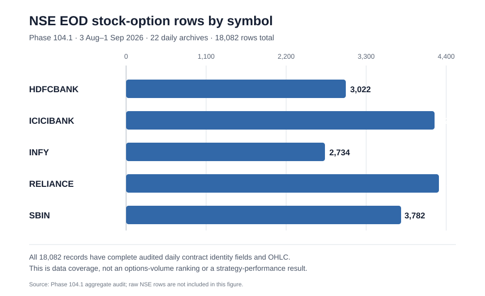

# Phase 104 Final Manuscript — EOD Contract Identity Feasibility for NIFTY 50 Stock Options

**Phase:** 104 — EOD contract-identified stock-options research  
**Branch:** `phase-104-eod-stock-options`  
**Closeout date:** 2026-10-11  
**Evidence source:** official NSE daily UDiFF F&O archives, bounded sample 2026-08-03 to 2026-09-02 (end exclusive)  
**Strategy performance:** not tested  
**Promotion decision:** none

## Abstract

This study tested whether official National Stock Exchange of India (NSE) end-of-day (EOD) Unified Distilled File Format (UDiFF) futures-and-options daily archive records provide a sufficiently complete, contract-identified data foundation for a separate daily-frequency stock-options study. The frozen five-stock basket comprised HDFCBANK, ICICIBANK, INFY, RELIANCE and SBIN. The bounded 30-calendar-day window generated 22 parsable trading-day archives and 18,082 stock-option daily rows. All selected rows had complete audited trade-date, symbol, expiry, strike and call/put identity fields, complete daily OHLC, non-missing volume/open interest/underlying/lot-size fields, zero date mismatches and zero duplicate daily contract keys. Volume was positive on 12,160 rows and exactly zero on 5,922 rows; none had missing volume. The EOD contract-identity gate therefore passed for this sample. A separate execution/cost feasibility review determined that daily OHLC does not establish historical bid/ask, depth, latency, partial fills or executable quantity. User-specific Paytm Money brokerage tier also remains unconfirmed, so a ₹10/₹15/₹20 per-order sensitivity is retained. Raw exchange records were not committed or uploaded. Under the registered stop rule, no strategy backtest or P&L calculation was run. The defensible conclusion is that contract-identified daily archive data are available for coverage and feature research, but they do not, by themselves, support a credible after-cost executable profitability claim.

**Keywords:** stock options; NSE; UDiFF; contract identity; EOD data; data quality; transaction costs; execution modelling; NIFTY 50.

## 1. Introduction

A historical options strategy study requires more than a collection of option prices. Every observation needs an unambiguous underlying, expiration date, strike, option side and trade date; time series must distinguish a missing record from an instrument that genuinely had no reported trading volume. Data completeness and contract identity are prerequisites for a meaningful backtest, but they are not evidence that a position could have been entered or exited at a quoted historical mark.

The preceding Phase 103 study tested a Dhan rolling-relative-strike endpoint. Its requests returned rows, yet the independent daily OHLC reconciliation was incomplete: only 3 of 88 eligible full-session exact-strike profiles uniquely matched four daily OHLC fields, all on expiry 25 August 2026, and none agreed with the expected listed-expiry rank for selector code 1. The code-0 near/current selector request was rejected by Dhan before returning observations. Phase 103 was closed without strategy P&L. This study was registered separately so the previous sample and conclusions remain frozen and are not silently pooled with EOD records.

The NSE lists daily derivatives reports and individual-security stock-option specifications, including the contract dimensions used to identify a listed option. The EOD/historical-data vending route is separate from an executable quote feed. Public source statements are cited to official NSE and Paytm Money webpages below; account-specific rights and fees were not inferred from the public pages. This investigation tests the daily-archive route only and states the boundary between source-data feasibility and execution feasibility explicitly.

## 2. Research questions

**RQ1.** Do official NSE daily UDiFF archive files provide stable daily contract identity for options on the five frozen stocks across the bounded sample?

**RQ2.** Are required identity and OHLC fields complete, and are duplicate daily keys, date mismatches, schema errors or unexplained missing values observed?

**RQ3.** Are true zero-volume observations distinguishable from missing volume and missing open interest/underlying/lot-size fields?

**RQ4.** Can the EOD archive plus publicly documented, date-effective fee inputs support a credible executable after-cost strategy test, without equating daily OHLC with bid/ask fills?

**RQ5.** What evidence would be needed to reopen numerical strategy testing while preserving rights, costs, chronological validation and the Phase 103 stop rule?

## 3. Aim and objectives

**Aim:** Establish whether the official NSE daily archive is an adequate source of exact-contract daily records for a separate stock-options research path, and identify whether it is adequate for executable profitability inference.

Objectives were to:

1. Process a prespecified 30-calendar-day sample and the five-stock frozen universe.
2. Validate archive schema, instrument type, trade date, expiry, strike and CE/PE fields.
3. Count daily contract-key duplicates and date mismatches.
4. Audit OHLC, volume, OI, underlying-value and lot-size completeness.
5. Quantify symbol-level coverage without treating zero volume as missing data.
6. Assess the permissions, retention, caching and derived-publication limits without publishing raw market rows.
7. build a source-based cost function for Paytm Money brokerage scenarios and date-effective exchange/statutory fees, while keeping unobserved execution costs explicit.
8. Apply a preregistered stop rule: no P&L from daily bars unless an adequate execution model exists.
9. Publish the reproducible audit, limitations, repository logs and final manuscript.

## 4. Literature and source review

### 4.1 Methodological context

Options research depends materially on liquidity and market microstructure. The bid–ask spread and price impact can make a nominal price signal unprofitable after execution; option markets are sensitive to trading activity and liquidity conditions. For strategy selection, multiple-testing and selection bias also require explicit treatment; an attractive in-sample result is not enough to establish a reproducible edge. This phase did not progress to signal testing, so these concepts inform the design boundary rather than serving as empirical results.

### 4.2 Source comparison

| Source | Relevance to this phase | Decision |
|---|---|---|
| Official NSE daily UDiFF F&O archive | Daily contract rows and fields suitable for identity, OHLC and coverage audit | Used for the bounded feasibility audit; aggregate output only |
| NSE individual-stock contract specifications | Grounding for expiry, strike and CE/PE contract identity | Used as specification reference |
| NSE historical order/trade product | Potential source for higher-resolution execution evidence | Candidate follow-up; package, fields, rights and price not confirmed and no purchase made |
| Global Datafeeds public API materials | Potential commercial historical NFO feed | Not used; exact expired-stock-option fields, bid/ask coverage and rights require written confirmation |
| Dhan rolling-relative-strike expired-options API | Phase 103 acquisition route, separate from this phase | Frozen; identity reconciliation failed; no further selector/date/stock/offset search allowed |
| Open-source daily archive mirrors and data clients | Useful implementation/discovery references | No market-data rights inferred from a code license; raw mirror was not copied |

The source screen distinguishes **technical download success**, **contract identity**, **execution price quality**, and **legal rights to cache or republish data** as separate gates. The user's Dhan subscription confirmation is accepted for that Dhan-access path; it is not treated as a licence to redistribute third-party or raw NSE data.

## 5. Materials and methods

### 5.1 Registered universe and period

The fixed basket was HDFCBANK, ICICIBANK, INFY, RELIANCE and SBIN. The basket originated in the prior registered stock-options plan and is not claimed to be a synchronized ranking of the five largest stocks by average options liquidity.

The target sample window was **2026-08-03 inclusive through 2026-09-02 exclusive**, at most 30 calendar days. This is a data-feasibility sample, not a training, independent test or holdout window.

### 5.2 Acquisition and data handling

The audit used the official NSE daily UDiFF F&O archive path by business date. For each requested calendar date it recorded only the fetch result, hash and row counts, then parsed the downloaded bytes in memory. The raw selected rows and raw archive payloads were not written into repository files or GitHub workflow artifacts. The workflow publishes aggregates, schema/quality diagnostics and archive SHA-256 values only.

An unavailable daily file was classified as “no archive or non-trading date” rather than silently converted to a successful empty file. Eight dates were without archives, corresponding to weekends in the period; 22 daily files parsed. Any source or schema errors would have blocked the audit.

### 5.3 Contract-key and field-quality audit

For each selected stock-option row, the parser retained in memory a daily key consisting of trade date, underlying symbol, expiry date, strike and CE/PE option side. The audit counted repeated keys, missing or malformed identity fields, rows whose trade date did not agree with the expected archive date, OHLC completeness, non-missing volume, OI, underlying price and lot size. Volume values were classified as positive, zero or missing, not conflated.

The audit acceptance rule required at least ten parsed trading-day archives, at least 99.9% complete identity fields, zero duplicate daily contract keys, zero date mismatch rows, no source/schema errors, and at least 99% OHLC completeness. This bounded sample met all numerical quality conditions.

### 5.4 Execution and transaction cost feasibility

A source-based fee function was added with date-effective components. The current Paytm Money F&O FAQ describes ₹10 per unique executed order, while the firm's brokerage-history page says account cohorts may remain on ₹10/₹15 or use ₹20 for newer customers. Because the user's individual account tier and contract notes were not inspected, the model preserves a ₹10/₹15/₹20 per-executed-order sensitivity rather than claiming a single account-specific tariff.

For the sample after 1 April 2026, the fee model includes the published option-sale STT rate of 0.15%, buy-side equity-option stamp duty of 0.003%, SEBI turnover fee of 0.0001%, GST on brokerage/exchange/SEBI service fees, NSE's transaction charge schedule effective 1 March 2026 (₹3,552 per crore of option-premium turnover per side), and an explicitly separate date-effective NSE IPFT contribution rate based on the official circular. The official circular rounds total member outflow to ₹3,553 per crore for options in its summary table; the model preserves transaction and IPFT components separately so the broker's billed treatment can be reconciled. GST treatment of a separately billed IPFT contribution is not assumed beyond the model's documented service-fee base. Exercise STT is represented separately, although initial candidates are intended to exit before expiry. The account-specific tariff and treatment of any separately billed IPFT/other broker charges should be reconciled to contract notes before actual P&L calculations.

The model deliberately returns **NOT_COMPUTABLE_WITHOUT_EXECUTABLE_FILL_MODEL** for net P&L. It does not synthesize bid/ask spreads, fills, queue position, slippage or latency from daily bars. These costs are not set to zero.

### 5.5 Statistical analysis

No strategy P&L, return series or trade sample was produced; inferential strategy statistics are therefore **not applicable / not run**. No win rate, expectancy, Sharpe ratio, drawdown, confidence interval, p-value or profit ranking is reported. If the execution gate is ever reopened, the registered strategy protocol requires chronological development/validation/independent test/holdout separation, small preregistered candidate families, date-effective Paytm Money and statutory costs, conservative execution assumptions, clustered uncertainty and multiple-testing corrections.

## 6. Results

### 6.1 Archive availability and aggregate data quality

The automated audit [run 38129590808](https://github.com/vishnuvcr/Final-Stand-v5-1-1-1/actions/runs/38129590808) passed the updated unit-test and acquisition/report publication steps, including the separately itemized NSE IPFT test. It parsed 22 official daily archives, had zero source/schema errors, and generated an aggregate machine-readable report without publishing raw records.

| Audit metric | Result |
|---|---:|
| Requested calendar days | 30 |
| Parsed daily archives / trade dates | 22 |
| No-archive dates | 8 |
| Source/schema errors | 0 |
| Selected five-stock option rows | 18,082 |
| Parsed rows | 18,082 |
| Identity-complete rows | 18,082 (100.0%) |
| OHLC-complete rows | 18,082 (100.0%) |
| Unique daily contract keys | 18,082 |
| Duplicate daily contract keys | 0 |
| Date-mismatch rows | 0 |
| Positive-volume rows | 12,160 |
| Zero-volume rows | 5,922 |
| Missing-volume rows | 0 |
| Missing OI / underlying / lot-size values | 0 / 0 / 0 |
| Raw rows persisted or uploaded | No / no |

The aggregate expiry-date counts in this sample were 6,234 rows for 25 August 2026, 6,977 for 29 September 2026, 4,161 for 27 October 2026 and 710 for 23 November 2026. These are row counts by expiry across the selected daily observations, not counts of unique option instruments over all time.

### 6.2 Symbol coverage

| Symbol | Rows | Distinct archive dates | Positive volume | Zero volume |
|---|---:|---:|---:|---:|
| HDFCBANK | 3,022 | 22 | 2,468 | 554 |
| ICICIBANK | 4,241 | 22 | 2,044 | 2,197 |
| INFY | 2,734 | 22 | 2,240 | 494 |
| RELIANCE | 4,303 | 22 | 3,035 | 1,268 |
| SBIN | 3,782 | 22 | 2,373 | 1,409 |
| **Total** | **18,082** | — | **12,160** | **5,922** |

*Figure 1. Aggregate number of daily stock-option rows processed for each frozen symbol. This is data coverage, not a market-liquidity ranking or strategy-performance result.*

The distinction between zero and missing volume matters. Nearly one-third of parsed rows showed reported volume equal to zero, while none had missing volume. A zero-volume contract-day is not evidence of an executable fill and should not be treated as if it had positive trading activity.

### 6.3 Contract identity versus executable prices

The identity and daily OHLC checks passed for this bounded source audit. This does not conflict with Phase 103: the EOD route is an independent dataset with its own daily contract key; the Dhan rolling-relative-strike route did not reconcile to the same daily prices across most eligible profiles. Phase 103 data were not pooled into this phase.

EOD OHLC and daily volume/OI do not show what bid or ask was available when an order was sent, how much size was resting in the book, whether an order would have been filled, or how much adverse price movement occurred between signal and execution. The audit therefore passed **daily contract identity**, but did not pass **execution-price quality**.

### 6.4 Cost feasibility

A cost function and regression tests are present in `research/phase104_eod_stock_options/cost_model.py` and `tests/phase104/test_cost_model.py`. The fee component model is implementable, and the ₹10/₹15/₹20 brokerage sensitivity is explicit. These calculations are not historical trade costs for any Phase 104 strategy, since no trades have been simulated and no user contract note has been reconciled. Unobserved spread, slippage, latency, impact and partial/missed fills remain a blocking input. No net return has been calculated.

## 7. Inferences

1. **Supported:** The official NSE EOD archive provided complete daily contract-identity and OHLC fields for all 18,082 selected rows in the bounded sample, with zero duplicate daily keys and zero date mismatches.
2. **Supported:** Missing and zero volume can be distinguished in this file format. The sample included 5,922 zero-volume records and no missing-volume records.
3. **Not supported:** The audit does not establish that the observed daily contract rows were liquid enough for intended position sizes or that daily OHLC could be achieved as execution prices.
4. **Not supported:** No conclusion can be made about whether any stock-option strategy is profitable or unprofitable. There was no strategy-P&L test.
5. **Decision:** Phase 104 has established EOD data feasibility but, under the registered stop rule, is **NOT TESTABLE for executable after-cost strategy profitability using this source sample alone**.

## 8. Discussion

The source-data question and the trading-strategy question have different evidence requirements. A daily file can carry contract identity and internally complete OHLC while providing no intraday order-book evidence. Treating these as interchangeable would create false confidence in fills and understate microstructure costs. The study therefore separates a successful EOD identity gate from a failed execution gate and stops before a strategy result could be overstated.

The result is not evidence that daily options research is impossible. EOD contract-identified data may support descriptive work, coverage studies, contract lifecycle analysis, daily feature construction or volatility/volume/OI research. However, using a daily close as an executable entry/exit price for a strategy would require a clear protocol, a conservative validated execution proxy, and sensitivity analysis. A proxy must be labelled as such and cannot be presented as observed bid/ask evidence.

The fee model is also a preparation step, not a complete cost validation. A live account can carry cohort-specific brokerage and additional charges. Any subsequent numerical P&L would need contract-note reconciliation, date-effective legal rates and an execution cost schedule; costs cannot be reduced to one generic brokerage value.

The next meaningful improvement is not another sweep of stocks, dates or strike offsets. It is to obtain or verify an authorized source with historical quote/trade evidence and exact expired contract identifiers, preferably with a small vendor-confirmed sample before any paid procurement or full dataset pull.

## 9. Strengths

- Registered, bounded and independently isolated phase with a clear stop rule.
- Frozen five-stock universe and fixed 30-calendar-day sample.
- Official daily archive source rather than scraped option-chain snapshots.
- Explicit contract identity, date, OHLC, zero-versus-missing and duplicate-key audits.
- Raw market rows remain ephemeral; publication includes aggregate counts and archive hashes only.
- Date-effective cost functions and boundary tests are separated from profitability claims.
- Failed execution feasibility is reported rather than filled with invented spread or slippage values.
- Phase 103 remains frozen and is not silently merged into the EOD study.

## 10. Limitations

- Only one month of daily archives was audited; multi-year stability, corporate actions and point-in-time universe membership are not established.
- Eight dates had no archive and were classified as no-archive/non-trading; the program does not independently distinguish every exchange holiday from a genuinely absent file.
- Completeness means fields were populated in the downloaded source, not that all fields are correct in the market microstructure sense or independently corroborated against contract notes.
- Raw NSE data caching, retention and derived-publication rights were not independently proven by technical file access; raw rows were not cached or published.
- EOD OHLC does not establish historical bid/ask, displayed depth, queues, order arrival, market impact, partial fills or execution latency.
- Paytm Money's user-specific brokerage cohort and exact contract-note component treatment were not verified.
- The strategy phase, independent test and sealed holdout were intentionally not entered; no strategy statistics can be reported.
- The sample does not estimate profitability for the five-stock basket or generalize to all NSE stock options.

## 11. Conclusion

The registered Phase 104.1 source/data gate **passed**: 18,082 five-stock daily stock-option records were extracted from 22 official NSE archives over the bounded window; all rows had complete audited identity and OHLC, zero duplicate daily keys and zero date mismatches. The source distinguishes true zero volume from missing volume.

The strategy execution gate **did not pass**. Daily OHLC is not historical bid/ask/depth or verified executable-fill evidence, and brokerage/fee arithmetic cannot substitute for realistic spread, slippage, latency and partial-fill modelling. As preregistered, strategy P&L and statistical testing were not run. No strategy is declared profitable, unprofitable, recommended or promoted.

**Final Phase 104 conclusion:** EOD records are suitable for a bounded daily contract-coverage audit, but this sample alone is insufficient to substantiate an executable after-cost options-strategy claim. Stop Phase 104 at this point. Reopen under a new phase only after an authorized, contract-identified source with suitable historical execution evidence and documented permitted use is verified.

## 12. Future research direction

1. Ask NSE Data & Analytics for written confirmation of exact stock-option contract identity fields, historical trade/order/quote granularity, retention/cache rights, automated testing use and derived-publication terms.
2. Evaluate a licensed vendor sample with at least three expiries and several symbols before procuring a longer history; require fixed expiry, strike, side, timestamps, volume/OI and bid/ask or time-stamped trade evidence.
3. Reconcile the cost engine against a sanitized Paytm Money contract note from the relevant account cohort, including all exchange, IPFT, SEBI, GST, STT, stamp duty and any exercise/assignment costs.
4. Only then register a narrow candidate family and freeze exact entry/exit rules, time availability, price-side conventions, lot sizes, corporate actions and max-risk policy.
5. Partition data chronologically into development, validation, independent test and one sealed holdout; control multiple strategy trials and report confidence intervals, drawdown, tail loss and cost stresses.
6. Keep daily descriptive research separate from intraday-execution claims; do not infer executable intraday prices from EOD OHLC.

## References

1. NSE India. *All Reports—Derivatives*. https://www.nseindia.com/all-reports-derivatives
2. NSE India. *Equity Derivatives—Individual Securities: Contract Specifications*. https://www.nseindia.com/static/products-services/equity-derivatives-individual-securities
3. NSE India. *EOD/Historical Data Subscription and Historical Order/Trade Data*. https://www.nseindia.com/static/market-data/eod-historical-data-subscription
4. NSE Data & Analytics. *Data and Information Vending*. https://www.nseindia.com/static/nse-data-and-analytics/data-information-vending
5. NSE India. *Securities Transaction Tax Computation*, rates effective 1 April 2026. https://www.nseindia.com/static/products-services/equity-derivatives-securities-transaction-tax
6. NSE India. *SEBI Turnover Fees, STT and Other Levies*. https://www.nseindia.com/static/invest/first-time-investor-sebi-turnover-fees-stt-other-levies
7. NSE India. *Revision in Transaction Charges*, circular NSE/FA/73061, 27 February 2026. https://nsearchives.nseindia.com/content/circulars/FA73061.pdf
8. Paytm Money. *F&O FAQ—Brokerage Charges*. https://www.paytmmoney.com/stocks/customer/fno-faq/onboarding-and-kyc/account-segment-activation/how-to-activate-fo-from-mobile-app-web
9. Paytm Money. *Brokerage Charges Increase From 25 August 2023; Existing Users Continue on Old Charges*. https://www.paytmmoney.com/blog/brokerage-charges-increase-from-25th-aug-23-existing-users-will-continue-on-old-brokerage-charges/
10. Bailey, D. H., & López de Prado, M. (2014). The Deflated Sharpe Ratio: Correcting for Selection Bias, Backtest Overfitting, and Non-Normality. *The Journal of Portfolio Management*, 40(5), 94–107. https://doi.org/10.3905/jpm.2014.40.5.094
11. Cho, Y.-H., & Engle, R. F. (1999). Modeling the Impacts of Market Activity on Bid-Ask Spreads in the Option Market. NBER Working Paper 7331. https://www.nber.org/papers/w7331

## Appendix A. Reproducibility record

- [Registered plan](../../PHASE104_RESEARCH_PLAN.md)
- [Phase status](../../PHASE104_STATUS.md)
- [Research log](../../PHASE104_RESEARCH_LOG.md)
- [Error and limitation log](../../PHASE104_ERROR_LOG.md)
- [Visible conversation log](../../PHASE104_CHAT_LOG.md)
- [Source screen](SOURCE_SCREEN.md)
- [EOD audit report](NSE_EOD_DATA_AUDIT.md)
- [Machine-readable aggregate audit](nse_eod_data_audit.json)
- [Execution/cost gate](EXECUTION_AND_COST_GATE.md)
- [Fee model](../../research/phase104_eod_stock_options/cost_model.py)
- [Regression tests](../../tests/phase104/)
- [Automated/manual workflow](../../.github/workflows/phase104-eod-stock-options-audit.yml)

## Appendix B. Decision gates

| Gate | Required evidence | Result |
|---|---|---|
| Official archive availability | Minimum ten parsed trade-day archives in the bounded sample | PASS: 22 |
| Contract identity fields | At least 99.9% complete selected records | PASS: 100.0% |
| Daily OHLC completeness | At least 99% complete | PASS: 100.0% |
| Duplicate daily contract keys | Zero unresolved duplicate keys | PASS: 0 |
| Date integrity | Zero row date mismatches | PASS: 0 |
| Zero vs. missing volume | Separate counts | PASS: 5,922 zero; 0 missing |
| Raw-data publication control | No raw market rows in repo or artifact | PASS: aggregate-only |
| Legal data retention/redistribution | Documented rights for raw cache/publication | NOT VERIFIED; raw rows not cached or published |
| Paytm Money fee inputs | Date-effective source schedule plus account-tier sensitivity | PARTIAL; general schedule model plus ₹10/₹15/₹20 sensitivity, no user contract-note reconciliation |
| Historical executable price quality | Historical bid/ask/trade evidence or independently validated conservative proxy | NO-GO / NOT AVAILABLE IN THIS SAMPLE |
| Strategy P&L / statistical inference | All prior data, rights, costs and execution gates pass | NOT RUN by design |
| Strategy promotion | All registered conditions pass | NONE |

## Appendix C. Model boundary

The provided fee function estimates a brokerage/levy schedule on supplied hypothetical buy/sell option premiums and quantities. It is **not a trading strategy**, it does not generate entries/exits, and it deliberately leaves spread/slippage/impact unmodelled. Its return field `net_pnl_status` remains `NOT_COMPUTABLE_WITHOUT_EXECUTABLE_FILL_MODEL`.
