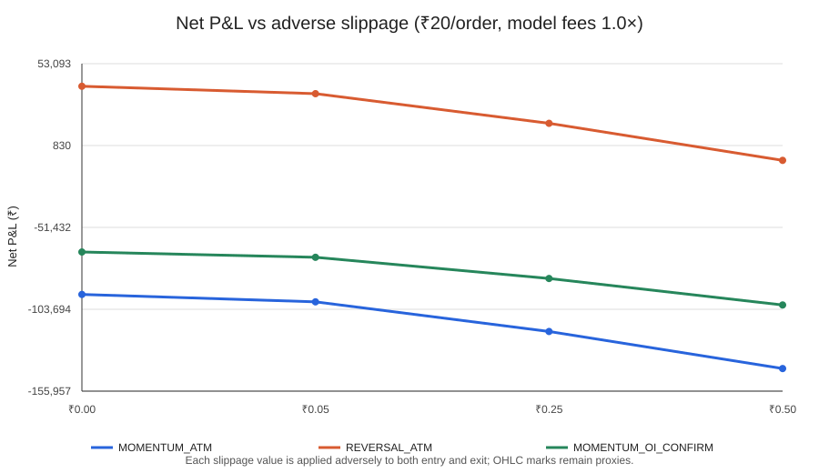

# Phase 105 — EOD OHLC Options Strategy Pilot

**Run:** [38131616138](https://github.com/vishnuvcr/Final-Stand-v5-1-1-1/actions/runs/38131616138)  
**Window:** 2026-08-03 inclusive to 2026-09-02 exclusive  
**Interpretation:** OHLC execution proxy only; not verified fills.  
**Decision:** COMPLETE_ACCOUNTING_CHECKS_PASS; promotion: NONE.

## Research question and methods

This bounded exploratory pilot asked whether three prespecified one-session long-option rules could survive costs and adverse slippage using the five-stock NSE EOD sample. Direction signals used prior-session underlying changes only. The contract selector used prior-session volume/OI, expiry, strike, underlying and lot size; eligible expiry was 7–35 days out, the earliest eligible expiry was selected, then the nearest strike. The exact same expiry/strike/side had to exist the next session. Proxy entry was next-session open and proxy exit was that same session's close. There was no overnight exposure, no short option, no expiry holding and no parameter search.

Candidates: MOMENTUM_ATM (follow prior underlying move), REVERSAL_ATM (invert it), and MOMENTUM_OI_CONFIRM (momentum only after same-side near-ATM aggregate OI increased). OI alone is not directional evidence; the last candidate was a simple exploratory filter.

## Source gate

- Official NSE archive sessions parsed: 22.
- Selected/parsed rows: 18,082 / 18,082.
- Identity completeness and OHLC completeness: 100% / 100%.
- Positive/zero/missing-volume rows: 12,160 / 5,922 / 0.
- Missing OI / underlying / lot size: 0 / 0 / 0.
- Duplicate daily keys / date mismatches: 0 / 0.
- Invalid positive-volume OHLC rows: 0.
- Sessions with all five underlying values: 22, 2026-08-03 to 2026-09-01.
- Raw market rows and row-level prices persisted/uploaded: no / no.

## Coverage and exclusions

| Strategy | Direction signals | Contracts selected | Completed OHLC proxy trades | No prior eligible contract | OI filter rejections | Missing exact next-session contract | Zero-volume target | Invalid target OHLC | Lot-size mismatch |
|---|---:|---:|---:|---:|---:|---:|---:|---:|---:|
| MOMENTUM_ATM | 99 | 79 | 79 | 20 | 0 | 0 | 0 | 0 | 0 |
| REVERSAL_ATM | 99 | 79 | 79 | 20 | 0 | 0 | 0 | 0 | 0 |
| MOMENTUM_OI_CONFIRM | 55 | 55 | 55 | 20 | 24 | 0 | 0 | 0 | 0 |

A no-prior-contract exclusion is not a loss. It means the registered eligible contract selector found no contract from information known at the signal close. Same-contract target coverage passed for every selected contract within this small sample, but that does not prove an order would fill at the next open/close.

## Primary registered cost case

Brokerage ₹20 per executed order, ₹0.25 adverse slippage per option unit on both sides, and 1.0× modelled fees.

| Strategy | Trades | Gross P&L | Model fees | Slippage cost | Net P&L | Return on premium | Win rate | Profit factor | Max drawdown (₹) | Mean daily P&L 95% session-bootstrap CI |
|---|---:|---:|---:|---:|---:|---:|---:|---:|---:|---|
| MOMENTUM_ATM | 79 | ₹-88,395.00 | ₹5,812.02 | ₹23,675.00 | **₹-117,882.02** | -12.1585% | 22.785% | 0.30262 | ₹123,599.29 | ₹-9,011.00 to ₹-2,638.14 |
| REVERSAL_ATM | 79 | ₹44,850.00 | ₹6,156.98 | ₹23,675.00 | **₹15,018.02** | 1.4912% | 39.241% | 1.13651 | ₹42,223.32 | ₹-2,682.37 to ₹3,957.35 |
| MOMENTUM_OI_CONFIRM | 55 | ₹-63,012.50 | ₹4,103.89 | ₹16,925.00 | **₹-84,041.39** | -11.9918% | 23.636% | 0.33070 | ₹85,292.63 | ₹-6,706.59 to ₹-1,703.86 |

The reversal candidate was positive under this assumed cost case, but its mean-daily session-bootstrap 95% interval crosses zero and the median trade was negative (−₹798.60). That is not reliable evidence of an edge.

## Strict stress case

Brokerage ₹20 per order, ₹0.50 adverse slippage per option unit on both sides, and 1.5× modelled fees.

| Strategy | Trades | Net P&L | Return on premium | Max drawdown (₹) |
|---|---:|---:|---:|---:|
| MOMENTUM_ATM | 79 | **₹-144,436.93** | -14.7177% | ₹146,753.64 |
| REVERSAL_ATM | 79 | **₹-11,709.36** | -1.1492% | ₹52,253.81 |
| MOMENTUM_OI_CONFIRM | 55 | **₹-102,999.67** | -14.5216% | ₹102,999.67 |

The reversal candidate's cost sensitivity shows the fragility directly: with ₹20/order and 1.0× model fees it nets +₹38,675.62 at assumed zero slippage, +₹33,944.10 at ₹0.05 per unit per side, +₹15,018.02 at ₹0.25, and −₹8,639.57 at ₹0.50. In the registered 1.5× fee stress plus ₹0.50 adverse slippage, it is −₹11,709.36. These slippage values are scenarios, not observed spreads.

## Cost sensitivity chart

The full 72-scenario table (three candidates × three brokerage levels × four slippage assumptions × two fee multipliers) is in [summary.csv](summary.csv); structured aggregate outputs are in [summary.json](summary.json).

## Statistical and accounting checks

- Eight Phase 105 unit tests passed; automated workflow run completed successfully.
- All 72 scenario rows were produced. Accounting invariants passed: gross price-proxy return less adverse slippage and modelled fees reconciles to net P&L; trade counts stay fixed across cost scenarios.
- The bootstrap resamples whole trading-day P&L clusters (2,000 draws, deterministic seed). Only 20 entry/outcome sessions remain after the registered warm-up; the intervals are descriptive, not a validation set or a multiple-testing-corrected efficacy test.
- Profit-factor denominator can be zero for a special case, but not in the primary outcomes. Net return uses premium deployed as the denominator, not total account equity. Drawdown is in rupees because this pilot had no registered funded account/position-sizing model.

## Strengths

- Frozen candidate rules and cost grid; no parameter search.
- Exact expiry/strike/side continuity was required from the signal close to the target session.
- Prior-information-only signals and contract selection, plus explicit coverage exclusions.
- Date-effective modeled statutory/exchange levies and brokerage sensitivity were applied; slippage was stressed rather than set to zero in the primary result.
- Raw exchange rows and per-trade price/contract records were not published.

## Limitations

- Only one short, previously inspected month and 20 post-warm-up outcome sessions; strong regime and sample uncertainty.
- OHLC open/close prices and daily volume do not establish actual executable-side prices, spread, depth, queue priority, latency, partial fills or market impact.
- Slippage assumptions were not estimated from live quotes or trades. Positive volume somewhere in the day does not prove liquidity at the open/close or for the modeled lot.
- The account-specific Paytm Money brokerage cohort/contract note was not inspected. Costs, GST treatment and fee multipliers remain modeled assumptions.
- One-month, five-stock basket does not include index volatility, broad regime, corporate-action adjustment over longer histories, FII/DII, news/sentiment, futures basis or global market factors; it cannot answer those broader project questions.
- All three rules are exploratory. No out-of-sample holdout exists for this window, and the dataset had already been inspected for feasibility.
- The pointwise daily cluster bootstrap does not fix selection bias or the short time series, and there is no credible basis for statistical significance claims.

## Conclusion and decision

**No strategy is promoted.** MOMENTUM_ATM and MOMENTUM_OI_CONFIRM were substantially negative across the registered cases. REVERSAL_ATM was only modestly positive under the primary assumed cost case, has a bootstrap confidence interval spanning zero and a negative median trade, and turns negative under stricter slippage/fee stress. The result is fragile and highly dependent on unverified execution assumptions.

This pilot is useful as a falsification-oriented implementation check—not evidence that a trading edge is proven or that every strategy is unprofitable. Do not trade these findings live.

## Future direction

The next useful step is not parameter tuning. Freeze these findings and use a separately registered independent sample spanning multiple expiries and regimes, with data-use rights confirmed and an execution model grounded in historical trades/quotes or a separately validated conservative proxy. Reconcile the user's actual Paytm Money contract note and levies; incorporate corporate actions and broader market-regime covariates only in a new plan; use a strict chronological untouched test and multiplicity-adjusted statistical protocol. Stop further research if no authorized independent sample can be obtained.
