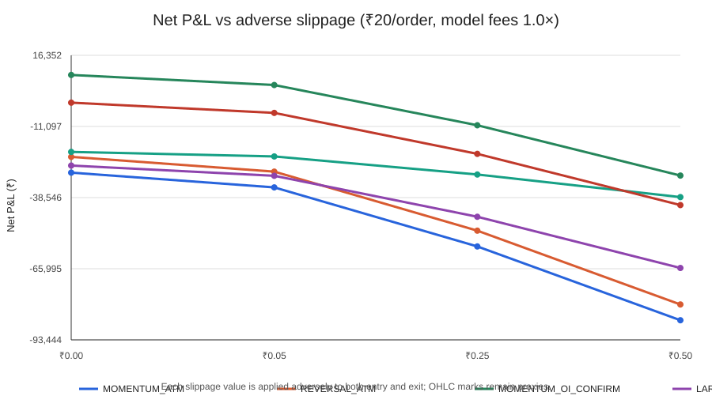

# Phase 107 — EOD OHLC Options Strategy Pilot

**Run:** 38167042024  
**Window:** 2026-09-02 inclusive to 2026-10-02 exclusive  
**Interpretation:** OHLC execution proxy only; not verified fills.  
**Decision:** COMPLETE_ACCOUNTING_CHECKS_PASS; promotion: NONE.

## Source gate

- NSE archive sessions parsed: 21
- Selected/parsed rows: 17791 / 17791
- Identity completeness: 100.0%
- OHLC completeness: 100.0%
- Duplicate daily keys / date mismatches: 0 / 0
- Invalid positive-volume OHLC rows: 0
- Common sessions with all five underlying values: 21
- Raw market rows persisted or uploaded: False / False

## Coverage and proxy fills

| Strategy | Signals | Contracts selected | Completed OHLC proxy trades | OI filter rejected | Missing next-session contract | Zero-volume target | Invalid target OHLC |
|---|---:|---:|---:|---:|---:|---:|---:|
| MOMENTUM_ATM | 95 | 95 | 95 | 0 | 0 | 0 | 0 |
| REVERSAL_ATM | 95 | 95 | 95 | 0 | 0 | 0 | 0 |
| MOMENTUM_OI_CONFIRM | 65 | 65 | 65 | 30 | 0 | 0 | 0 |
| LARGE_MOVE_MOMENTUM | 67 | 67 | 67 | 0 | 0 | 0 | 0 |
| SMALL_MOVE_REVERSAL | 28 | 28 | 28 | 0 | 0 | 0 | 0 |
| LARGE_MOVE_REVERSAL | 67 | 67 | 67 | 0 | 0 | 0 | 0 |

## Primary registered cost case

Brokerage ₹20 per order, ₹0.25 adverse slippage per option unit on both sides, 1.0× modelled fees.

| Strategy | Trades | Gross P&L | Model fees | Slippage cost | Net P&L | Net return on premium | Win rate | Profit factor | Max drawdown (₹) | Mean daily P&L 95% session-bootstrap CI |
|---|---:|---:|---:|---:|---:|---:|---:|---:|---:|---|
| MOMENTUM_ATM | 95 | ₹-21,775.00 | ₹7,117.82 | ₹28,500.00 | ₹-57,392.82 | -4.9831% | 30.526% | 0.63635 | ₹93,318.30 | ₹-7,061.92 to ₹2,214.76 |
| REVERSAL_ATM | 95 | ₹-15,520.00 | ₹7,288.17 | ₹28,500.00 | ₹-51,308.17 | -4.2106% | 33.684% | 0.65529 | ₹87,274.01 | ₹-6,750.41 to ₹1,108.09 |
| MOMENTUM_OI_CONFIRM | 65 | ₹13,890.00 | ₹5,095.92 | ₹19,425.00 | ₹-10,630.92 | -1.2363% | 36.923% | 0.8951 | ₹51,594.51 | ₹-4,307.79 to ₹4,394.77 |
| LARGE_MOVE_MOMENTUM | 67 | ₹-21,275.00 | ₹4,891.08 | ₹19,775.00 | ₹-45,941.08 | -6.0254% | 28.358% | 0.5703 | ₹76,429.24 | ₹-5,574.76 to ₹1,395.19 |
| SMALL_MOVE_REVERSAL | 28 | ₹-18,810.00 | ₹2,100.78 | ₹8,725.00 | ₹-29,635.78 | -8.4436% | 28.571% | 0.41564 | ₹34,237.13 | ₹-3,125.53 to ₹-236.54 |
| LARGE_MOVE_REVERSAL | 67 | ₹3,290.00 | ₹5,187.39 | ₹19,775.00 | ₹-21,672.39 | -2.4981% | 35.821% | 0.77915 | ₹57,030.77 | ₹-4,376.80 to ₹1,978.34 |

## Strict stress case

Brokerage ₹20 per order, ₹0.50 adverse slippage per option unit on both sides, 1.5× modelled fees.

| Strategy | Trades | Net P&L | Net return on premium | Max drawdown (₹) |
|---|---:|---:|---:|---:|
| MOMENTUM_ATM | 95 | ₹-89,420.31 | -7.669% | ₹113,493.85 |
| REVERSAL_ATM | 95 | ₹-83,420.84 | -6.7668% | ₹108,325.02 |
| MOMENTUM_OI_CONFIRM | 65 | ₹-32,582.46 | -3.7467% | ₹64,456.70 |
| LARGE_MOVE_MOMENTUM | 67 | ₹-68,139.82 | -8.8225% | ₹90,929.58 |
| SMALL_MOVE_REVERSAL | 28 | ₹-39,401.55 | -11.0882% | ₹42,905.90 |
| LARGE_MOVE_REVERSAL | 67 | ₹-44,019.29 | -5.0168% | ₹71,071.04 |

## Cost sensitivity chart

## Interpretation and limits

- The signal is formed using only the two prior sessions' underlying values. Contract selection uses only signal-session contract records, prior-session volume/OI, strike/expiry and lot size. The target session is used only to evaluate the registered open-to-close price proxy.
- The six rules are prespecified exploratory candidates, not an optimized search. The 0.5% one-session return threshold is a fixed screening threshold, not optimized on this sample. OI is not intrinsically bullish or bearish; the OI rule is only a simple confirmation filter.
- A price-proxy trade is counted only when the same expiry/strike/side appears on the target date with a positive-volume bar, internally consistent OHLC and matching lot size. Exclusions are enumerated; no price is interpolated.
- Brokerage, statutory levies and GST are model estimates. Brokerage tiers are sensitivities, not confirmation of the user's Paytm Money account tier. The 1.5× case is a stress overlay, not a tax rule.
- Applied slippage is an assumption, not observed bid/ask spread, queue/depth, latency, partial-fill or impact data. Bar open/close are not guaranteed order fills; the backtest cannot support execution or live-profitability claims.
- This is one month of already-inspected data, with few independent sessions and correlated same-day stock trades. Bootstrap intervals are descriptive and do not validate a trading edge. Net return is divided by premium deployed, not total account equity. Drawdown is reported in rupees because no funded portfolio sizing rule was preregistered.
- No strategy is promoted irrespective of the printed results. Further work requires a longer, independently frozen sample across multiple expiries/regimes and an execution evidence/licensing review.

## Accounting and decision

- Accounting check: PASS.
- Scenario rows: 144 (expected 144).
- Raw market rows and per-trade records are not published; aggregate summaries only.
- This is a short, previously inspected OHLC proxy sample; no strategy is promoted irrespective of simulated returns.
- Daily open/close marks do not verify executable fills, spread, depth, latency, partial fills or market impact.
